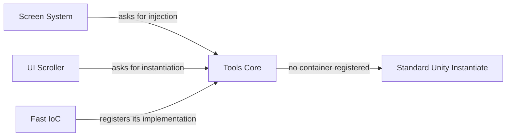

# API Reference

[← Back to README](../README.md)

- [How the packages connect](#how-the-packages-connect)
- [Types](#types)
- [Requirements](#requirements)

---

## How the packages connect

Screen System and UI Scroller only know about Tools Core. Neither depends on Fast IoC, so you can swap in another container or use none. UI Tweens and UI Foundations don't use Tools Core.

## Types

| Type | Purpose |
|---|---|
| `IMonoBehaviourInjector` | Injects dependencies into a MonoBehaviour |
| `NullMonoBehaviourInjector` | Does nothing. It's the default when no container is registered. |
| `IPrefabInstantiator` | Instantiates a prefab, optionally with injection and data |
| `NullPrefabInstantiator` | Uses `Object.Instantiate`. It ignores any data passed to it. |
| `IInstantiable` | Marks a component for container-aware instantiation |
| `IInjectingPrefabInstantiator` | Marks an `IPrefabInstantiator` that already injects what it creates, so tools don't inject it a second time |
| `ToolInjectionServices` | Holds the current injector (`MonoBehaviourInjector`) and prefab instantiator (`PrefabInstantiator`). `InstantiatorInjects` tells tools whether the instantiator injects. |
| VContainer and Zenject adapters | Optional. They compile only when VContainer or Extenject is in the project. See [Containers](containers.md#use-vcontainer). |

## Requirements

| Requirement | Supported |
|---|---|
| Unity | Tested on Unity 6 (`6000.3.16f1`). The package declares `2022.3` as its minimum, but older versions aren't tested yet. |
| Scripting backend | Not verified yet. The package uses no reflection, so Mono and IL2CPP are expected to work. |
| Platforms | Not verified yet |
| Dependencies | None |
