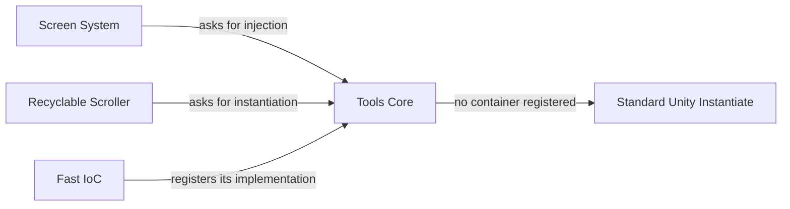

# Tools Core

**Shared injection interfaces for Screen System, Recyclable Scroller and Fast IoC.**

[](LICENSE)
[](#compatibility)
[](CHANGELOG.md)

Tools Core holds the shared dependency injection interfaces (`IMonoBehaviourInjector`, `IPrefabInstantiator`) that let Screen System and Recyclable Scroller work with Fast IoC, Zenject (Extenject), VContainer or no container at all in Unity 6.

Tools Core lets these packages work with dependency injection without depending on one container. Screen System and Recyclable Scroller use the interfaces here, and Fast IoC implements them. Without a container, the defaults fall back to standard Unity instantiation.

Tools Core is shared code, not a standalone tool: it's a required dependency of Fast IoC. Screen System and Recyclable Scroller, two UI packages that use it, aren't published yet. UI Tweens doesn't use it.

Like the packages that use it, it comes from tools I built on my own time in personal projects. It isn't used in production yet. I extracted it into this standalone package in November 2026. Earlier history lives in a private repository.

## How the packages connect



Screen System and Recyclable Scroller only know about Tools Core. Neither depends on Fast IoC, so you can swap in another container or use none.

## Do I need to install this myself?

Yes, if you use Fast IoC. Install Tools Core first, because Unity doesn't install Git dependencies automatically. UI Tweens doesn't need it.

## What's included

| Type | Purpose |
|---|---|
| `IMonoBehaviourInjector` | Injects dependencies into a MonoBehaviour |
| `NullMonoBehaviourInjector` | Does nothing. It's the default when no container is registered. |
| `IPrefabInstantiator` | Instantiates a prefab, optionally with injection and data |
| `NullPrefabInstantiator` | Uses `Object.Instantiate`. It ignores any data passed to it. |
| `IInstantiable` | Marks a component for container-aware instantiation |
| `ToolInjectionServices` | Holds the current injector and prefab instantiator. |

## Compatibility

| Requirement | Supported |
|---|---|
| Unity | Tested on Unity 6 (`6000.3.16f1`). The package declares `2022.3` as its minimum, but older versions aren't tested yet. |
| Scripting backend | Not verified yet. The package uses no reflection, so Mono and IL2CPP are expected to work. |
| Platforms | Not verified yet |
| Dependencies | None |

## Installation

Git must be installed on your machine.

1. In Unity, open **Window > Package Manager**.
2. Select **+ > Add package from git URL**.
3. Enter:

```text
https://github.com/sgonzalezrozo/unity-tools-core.git
```

To pin a release, add its tag:

```text
https://github.com/sgonzalezrozo/unity-tools-core.git#v0.3.1
```

## Use your own container

Fast IoC registers itself automatically. To use another container, implement `IMonoBehaviourInjector` and register it before the first scene loads:

```csharp
using ToolsCore;
using UnityEngine;

public sealed class MyContainerInjector : IMonoBehaviourInjector
{
    public void InjectIfNeeded(MonoBehaviour component)
    {
        // Call your container's injection method here.
    }
}

public static class MyContainerBootstrap
{
    [RuntimeInitializeOnLoadMethod(RuntimeInitializeLoadType.BeforeSceneLoad)]
    private static void Register()
    {
        ToolInjectionServices.MonoBehaviourInjector = new MyContainerInjector();
    }
}
```

Passing `null` restores the default injector.

To control prefab instantiation too, implement `IPrefabInstantiator` and assign it to `ToolInjectionServices.PrefabInstantiator`.

### Example: Zenject

This example connects [Extenject (Zenject)](https://github.com/Mathijs-Bakker/Extenject) using its project-wide container. Screen System and Recyclable Scroller then use Zenject without knowing about it.

```csharp
using ToolsCore;
using UnityEngine;
using Zenject;

public sealed class ZenjectInjector : IMonoBehaviourInjector
{
    public void InjectIfNeeded(MonoBehaviour component)
    {
        ProjectContext.Instance.Container.Inject(component);
    }
}

public sealed class ZenjectPrefabInstantiator : IPrefabInstantiator
{
    private static DiContainer Container => ProjectContext.Instance.Container;

    public GameObject Instantiate(GameObject prefab, Transform parent = null)
        => Container.InstantiatePrefab(prefab, parent);

    // Zenject has no equivalent of the data argument, so this example ignores it.
    public GameObject Instantiate(GameObject prefab, Transform parent, object data)
        => Container.InstantiatePrefab(prefab, parent);

    public T Instantiate<T>(GameObject prefab, Transform parent = null) where T : Component
        => Container.InstantiatePrefabForComponent<T>(prefab, parent);

    public T Instantiate<T>(GameObject prefab, Transform parent, object data) where T : Component
        => Container.InstantiatePrefabForComponent<T>(prefab, parent);
}

public static class ZenjectBootstrap
{
    [RuntimeInitializeOnLoadMethod(RuntimeInitializeLoadType.BeforeSceneLoad)]
    private static void Register()
    {
        ToolInjectionServices.MonoBehaviourInjector = new ZenjectInjector();
        ToolInjectionServices.PrefabInstantiator = new ZenjectPrefabInstantiator();
    }
}
```

The project container can't see bindings from a `SceneContext`. To inject scene bindings, resolve the current scene's container instead.

## FAQ

### Do I need Tools Core?

Yes, if you use Fast IoC. Install it first, because Unity doesn't install Git dependencies automatically.

### Can I use Screen System or Recyclable Scroller with Zenject or VContainer?

Yes. Implement `IMonoBehaviourInjector` and `IPrefabInstantiator`, and assign them to `ToolInjectionServices`. See [Use your own container](#use-your-own-container).

### What happens without a container?

The defaults use `Object.Instantiate` and inject nothing.

### How do I install it?

In Unity, open **Window > Package Manager**, select **+ > Add package from git URL** and enter `https://github.com/sgonzalezrozo/unity-tools-core.git`. See [Installation](#installation).

### Is it production-ready? Does anyone use it?

Not yet. Tools Core is a pre-release package (`0.x`) by a single author. It isn't used in a shipped game, and it has no other users yet, so expect rough edges and API changes before `1.0.0`. Bug reports are very welcome. See [Project status](#project-status).

### Is it free for commercial use?

Yes. It's MIT licensed.

## Project status

This is a pre-release package at version `0.3.1`. Its API and behavior may change before `1.0.0`. Not yet used in a shipped game.

Until `1.0.0`, minor versions (`0.x.0`) can include breaking changes, and patch versions (`0.x.y`) don't. Breaking changes are marked **Breaking** in the [changelog](CHANGELOG.md).

There's no public roadmap yet. Planned work is tracked in [issues](https://github.com/sgonzalezrozo/unity-tools-core/issues).

## Contributing

Bug reports and pull requests are welcome. Please open an issue before starting a large change. See the [contributing guide](.github/CONTRIBUTING.md) and [security policy](.github/SECURITY.md).

## Related packages

| Package | Purpose |
|---|---|
| [Unity Architecture Agents](https://github.com/sgonzalezrozo/unity-architecture-agents) | Architecture rules for coding agents |
| [Fast IoC](https://github.com/sgonzalezrozo/unity-fast-ioc) | Code-generated dependency injection |
| [UI Tweens](https://github.com/sgonzalezrozo/unity-ui-tweens) | ECS-based UI animation |
| [UI Foundations](https://github.com/sgonzalezrozo/unity-ui-foundations) | uGUI click Controllers and view states |

## License

Released under the [MIT License](LICENSE).
